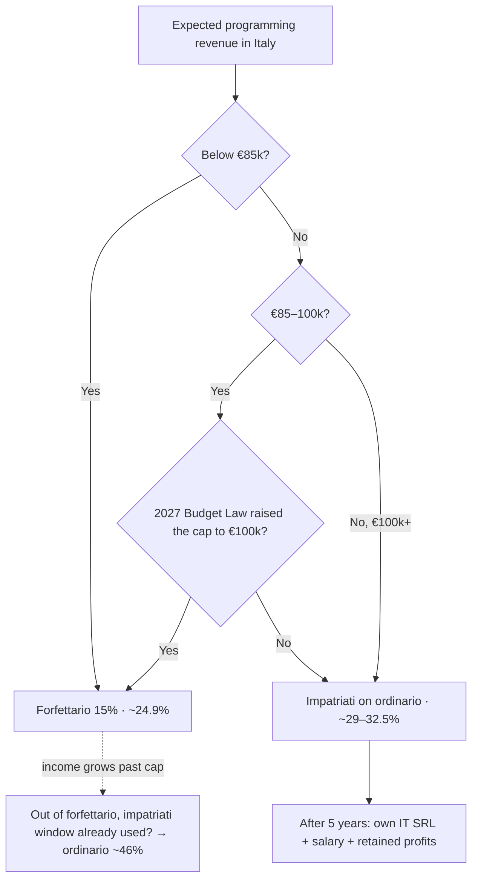

# IT Contractor Tax — Poland vs Italy

> [!summary] TL;DR
> - **At €100k+ the Italian answer is [[Regime Impatriati]] on the ordinary regime: ~29–32.5% total burden.** Forfettario doesn't exist above €85k; plain ordinario is ~46%.
> - **Poland (ryczałt 12% + full ZUS) stays cheaper: ~20.5%.** Gap vs impatriati ≈ **€8.5–12k/year**. The whole gap is social contributions; Italian *income tax* under impatriati is actually lower than ryczałt.
> - **Impatriati and forfettario are mutually exclusive and are chosen at the moment of moving.** Wait for the final 2027 Budget Law (due by 31 Dec 2026) before transferring residence: if the forfettario cap rises to €100k and income lands at €85–100k, forfettario (~24.9%) beats impatriati.
> - **The 50% stake in the Italian construction SRL causes no problems** if you stay a passive shareholder: no salary, no work, no invoices between your P.IVA and the SRL.
> - The 5% start-up rate is almost certainly unavailable (prior JDG activity in Poland).

---

## 1. Profile & assumptions

| Item | Value |
|---|---|
| Activity | Software programming, B2B contractor (ATECO 62.10.00) |
| Current setup | Polish JDG, ryczałt 12%, moving to full ZUS (~2 years in business) |
| Expected revenue | €60k now → **€100k+** target |
| Business expenses (for ordinario/impatriati) | assumed €10k on €100k revenue |
| Other asset | **50%** of an **Italian** construction SRL; the other 50% partner is the sole director |
| Your role in the SRL | passive shareholder: not director, no compenso, not *socio lavoratore* |
| FX | 1 EUR = 4.3775 PLN (NBP, 2026-10-09); calculations use 4.38 |
| Year of rules | 2026 unless stated; 2027 changes in [[#8. Watchlist — 2027]] |

---

## 2. The regimes in brief

### 🇵🇱 Ryczałt 12% + full ZUS (2026)
- **Tax:** 12% of revenue for programming services. Base = revenue − social contributions paid − 50% of health contribution paid. Revenue limit €2m.
- **Social ZUS (full):** base 5,652 zł → **1,926.76 zł/month** incl. voluntary sickness + FP/FS (23,121 zł/yr). Fixed amount, independent of income.
- **Health (ryczałt):** fixed per revenue band — **498.35** (≤60k zł) / **830.58** (60–300k zł) / **1,495.04 zł/month** (>300k zł). The 300k zł band starts at ≈ €68.5k.
- **Marginal rate ≈ 12%**: extra revenue moves nothing but the tax (until a health band jumps).

### 🇮🇹 [[Regime Forfettario]]
- **Base:** revenue × coefficient. Programming (62.10.00) = **67%**. Real expenses ignored.
- **Tax:** imposta sostitutiva **15%** (standard). **5%** for the first 5 years only for genuinely new activity — see [[#6. Risks & traps]].
- **[[Gestione Separata INPS]] 2026:** **26.07%** (24% if already covered by another mandatory scheme). Ceiling €122,295; €18,808 is only the threshold for a full year of pension credit — **no fixed minimum payment**.
- Contributions paid in the year are deducted from the base before the 15%/5% (cash basis — nothing to deduct in year 1).
- **Limits:** €85k → exit from the **next** year; **>€100k → immediate exit in the same year**, IRPEF on the whole year and VAT from the invoice that crossed the line.
- Other exclusions: employment/pension income >€30k in the prior year (from 2027; €35k in 2026); billing mostly a former employer; certain shareholdings (see §4).
- **Marginal rate ≈ 24.9%**, flat at every revenue level.
- ⚠️ For 62.10.00 some commercialisti push registration as *artigiano* (Gestione Artigiani, fixed ~€4.5k/yr minimum). Pure software services usually go to Gestione Separata — confirm before opening the P.IVA.

### 🇮🇹 Ordinario (lavoro autonomo)
- Real expenses deductible. INPS 26.07% on actual income, deductible from IRPEF base.
- **IRPEF 2026:** 23% to €28k · 33% €28–50k · 43% above €50k. Plus regional (1.23–3.33%) and municipal (≤0.9%) surcharges. No IRAP for individuals. VAT 22% (reverse charge for EU B2B; out of scope for non-EU).
- **Marginal rate ≈ 60%** at €100k.

### 🇮🇹 [[Regime Impatriati]] (D.Lgs. 209/2023)
- **50% of income exempt** (60% with a minor child), 5 tax years, income cap €600k. Applies to self-employment; runs on the ordinary regime.
- **Conditions:** non-resident in Italy for the 3 prior tax years ✅ (Poland); commit to stay resident 4 years (leave early → clawback with interest); work mainly in Italy; *elevata qualificazione* — degree (3+ years tertiary) or, for ICT, documented professional experience. **Gather evidence before moving.**
- **INPS is charged on 100% of income** — the exemption doesn't touch contributions.
- **Not compatible with forfettario** (prevailing AdE position; some commentary claims otherwise — don't rely on it).
- Open point: whether INPS contributions are deductible **in full** or **pro rata** (50%) against the reduced base → the 29% vs 32.5% range below.

### 🇮🇹 Own IT SRL (later option)
- IRES 24% + **IRAP 3.9%** (still applies to companies) + administrator INPS 33.72% (2/3 company, 1/3 you) + IRPEF on salary; dividends 26% on distribution.
- Rough burden on €100k: **~31% if profits stay in the company, ~42% if fully distributed.** Only wins if you don't consume most of the income.

---

## 3. Numbers

### 3.1 €60k revenue (€5k/month)

| | 🇵🇱 Ryczałt + full ZUS | 🇮🇹 Forfettario 15% | 🇮🇹 Forfettario 5% |
|---|---|---|---|
| Revenue | 262,800 zł | €60,000 | €60,000 |
| Social / INPS | 23,121 zł | €10,480 (26.07% × €40,200) | €10,480 |
| Health | 9,967 zł | — | — |
| Tax | 28,163 zł (12% × 234,695) | €4,458 | €1,486 |
| **Total** | **61,252 zł = €13,984** | **€14,938** | **€11,966** |
| **Burden** | **23.3%** | **24.9%** | **19.9%** |
| **Net / year** | **€46,016** | **€45,062** | **€48,034** |
| Net / month | €3,835 | €3,755 | €4,003 |

Year 1 in Italy is slightly worse (no contributions to deduct yet): 5% → 20.8%.

### 3.2 €100k revenue, €10k real expenses

| | 🇵🇱 Ryczałt + full ZUS | 🇮🇹 Impatriati (50%) | 🇮🇹 Ordinario |
|---|---|---|---|
| Revenue | 438,000 zł | €100,000 | €100,000 |
| Taxable income | — | €90,000 → €45,000 enters IRPEF | €90,000 |
| Social / INPS | 23,121 zł | €23,463 | €23,463 |
| Health | 17,940 zł (band 3) | — | — |
| IRPEF / tax | 48,709 zł | €4,954 – €8,179 | €20,811 |
| Surcharges | — | €538 – €832 | ~€1,683 |
| **Total** | **89,771 zł = €20,495** | **€28,955 – €32,474** | **€45,957** |
| **Burden** | **20.5%** | **29.0% – 32.5%** | **46.0%** |
| **Net after expenses** | **€69,505** | **€57,526 – €61,045** | **€44,043** |

- Impatriati range: full vs pro-rata deduction of INPS. *Detrazioni per lavoro autonomo* (~€400–700 at this level) ignored → slightly conservative.
- With a minor child (60% exempt): ~26.7% – 30.2%.
- Ordinario IRPEF: 28,000 × 23% + 22,000 × 33% + 16,537 × 43% on a base of €66,537.

### 3.3 Effective burden by revenue

| Revenue / yr | 🇵🇱 PL | 🇮🇹 Forfettario 15% | 🇮🇹 Forfettario 5% | 🇮🇹 Impatriati | 🇮🇹 Ordinario |
|---|---|---|---|---|---|
| €40k | 29.0% | 24.9% | 19.9% | — | — |
| €60k | 23.3% | 24.9% | 19.9% | — | — |
| €85k | 22.0% | 24.9% | 19.9% | — | — |
| €100k | 20.5% | n/a (cap) | n/a | 29–32.5% | 46% |

- **PL vs forfettario 15% break-even ≈ €52.6k/yr** (~€4.4k/month). Below it Italy is cheaper, above it Poland is.
- Poland keeps getting cheaper as income grows (fixed ZUS is diluted); Italy's forfettario is a flat 24.9%; ordinario climbs fast.
- Forfettario vs impatriati crossover ≈ €80k — but above €85k only impatriati is available anyway.

### 3.4 Where the gap actually comes from (€100k)

| | 🇵🇱 | 🇮🇹 Impatriati |
|---|---|---|
| Contributions | €9,375 (social + health) | €23,463 |
| Income tax | €11,121 | €5,500 – €9,000 |

> [!note] Insight
> Italian income tax under impatriati is **lower** than Polish ryczałt. The entire gap is **contributions**: full ZUS is a fixed ~5% of revenue at €100k; INPS is 23.5% because it scales with income up to €122,295.
> INPS builds real pension capital on a €90k base; ZUS builds it on a 5,652 zł base regardless of what you earn. Part of the "cost of Italy" is forced pension saving — whether that's a cost depends on how much you trust the Italian pension system 30 years out.

---

## 4. The 50% construction SRL

**Facts:** Italian SRL · 50% yours · other 50% partner is the sole director · you are passive.

| Question | Answer |
|---|---|
| Does it block forfettario? | **No.** Exclusion needs *both* control *and* related activity (L. 190/2014, c. 57 lett. d). AdE practice treats 50% as control (risposta 151/2019, per commentary), but with the partner as sole director the de facto control argument is weak. Either way activities aren't related: construction = ATECO section **F**, programming = section **J** (Circ. 9/E/2019; risposta 119/2019). |
| Does it matter at €100k+? | **No** — forfettario is off the table anyway. It matters again only if income drops below €85k. |
| Does it block impatriati? | No. Owning an Italian company while non-resident is fine. |
| Dividends | 26% withholding, **final**, not in your return, outside forfettario/impatriati limits, **not** covered by the impatriati exemption. |
| Esterovestizione / quadro RW | Not applicable — the SRL is Italian. |
| SRL vs SNC/SAS | Being an SRL matters: a stake in a *società di persone* would exclude forfettario automatically. |

**Rules to keep:**
- ❌ No compenso amministratore (it's employment-type income → €30k limit for forfettario from 2027).
- ❌ Don't become *socio lavoratore* → Gestione Artigiani with fixed ~€4.6k/yr. The resulting cut of your Gestione Separata rate to 24% (~€1.9k saved on €90k) doesn't pay for it.
- ❌ **No invoices** between your P.IVA and the SRL — related-party pricing scrutiny, and the cleanest way to hand AdE a "related activity" argument.
- ✅ Agree with your partner to retain profits in the SRL until you actually need the cash.

---

## 5. Decision tree

> [!warning] The trap in the dotted line
> Starting on forfettario "to test" and then growing past €100k leaves you on ordinario (~46%) — the impatriati choice is made at the move. If €100k+ is realistic, **start directly on ordinario + impatriati**.

---

## 6. Risks & traps

**5% rate — assume you won't get it.** It requires no business/professional activity in the 3 years before starting (foreign activity counts — AdE risposta 197/2022) and no *mera prosecuzione* (same work, same clients). Your current JDG fails the first test on dates alone.

**Crossing €100k in forfettario** = retroactive exit for the whole year: IRPEF instead of 15%, INPS on real income, 22% VAT on invoices you issued without it (painful for Italian clients, ~zero for EU B2B reverse charge), surcharges, 70% penalty, interest. On €60k that's roughly €10–25k per affected year. Audit window: 5 years after the return.

**Impatriati clawback** if you leave Italy within 4 years.

**Residence timing.** Italian tax residence = 183+ days (domicile, residence or registry). A late-year move makes that year non-resident; Italian-source work done there is still taxed in Italy as a non-resident, and the impatriati clock starts the next year. Moving in **H1** gives a clean first year.

**Cash flow.** Poland: fixed monthly payments by the 20th. Italy: nothing monthly, then balance + 1st advance (June) and 2nd advance (November). Reserve for it.

---

## 7. Action plan

### Before moving
- [ ] Decide the income scenario honestly (€85k vs €100k+).
- [ ] Wait for the final 2027 Budget Law text (≤ 31 Dec 2026), then pick forfettario or impatriati.
- [ ] Collect *elevata qualificazione* evidence: apostilled/translated diploma or documented ICT experience.
- [ ] Hire a commercialista specialised in *rientro in Italia / regimi agevolati* (budget €1.5–3k/yr).
- [ ] Confirm Gestione Separata vs Gestione Artigiani for your ATECO code.
- [ ] Plan the JDG closure: final ZUS/ryczałt settlement, wyrejestrowanie, notify the change of tax residence.
- [ ] Target a move in H1 2027.

### At the move
- [ ] Register residence; open P.IVA under the chosen regime (impatriati: claim it in the first return).
- [ ] Set up bookkeeping for real expenses from day one (ordinario/impatriati) — every €1k documented saves ~€300.

### Ongoing
- [ ] Add **rivalsa INPS 4%** to invoices (≈ €4k/yr on €100k), where clients accept it.
- [ ] Keep the client base mostly outside Italy (EU B2B reverse charge / non-EU).
- [ ] Pay contribution advances before 31 Dec to deduct them in the same year.
- [ ] Forfettario only: track revenue quarterly; soft stop at ~€82k; shift invoices to January if needed (cash basis = collected, not invoiced).
- [ ] Complementary pension fund: deductible up to €5,164.57/yr (~€1.2–1.7k real saving on ordinario/impatriati).
- [ ] Keep the SRL rules in §4.
- [ ] Year 5 of impatriati: model the switch to your own IT SRL.

---

## 8. Watchlist — 2027

| Item | Status (Oct 2026) | Impact |
|---|---|---|
| Forfettario cap €85k → €100k | **Proposal** for the 2027 Budget Law; collides with the EU VAT small-business threshold (needs directive change or decoupling) | High — decides forfettario vs impatriati at €85–100k |
| IRPEF 33% band extended to €60k | Proposal; max benefit ~€1k/yr | Low — impatriati base is €21–33k |
| Employment-income limit for forfettario back to €30k | **In force** from 1 Jan 2027 | None (no salary from SRL) |
| PL full ZUS 2027 | Budget draft: average wage 10,033 zł → base 6,019.80 zł → **2,052.15 zł/month** (+125 zł) | Low — PL at €100k ≈ 21.0% |
| PL ryczałt health 2027 | Not yet published (expected early 2027) | Low |
| Budget Law approval | Deadline 31 Dec 2026 | Trigger for the regime decision |

---

## 9. Open questions → commercialista / interpello

1. **Impatriati: full vs pro-rata deduction of INPS** against the reduced base (≈ €3.5k/yr). No published guidance → good *interpello* candidate.
2. Gestione Separata vs Artigiani for 62.10.00 in your actual workflow.
3. *Elevata qualificazione*: is your documentation sufficient?
4. If the forfettario cap rises: how the €100k immediate-exit trigger changes.

> [!info] Interpello mechanics
> Written ruling request (art. 11, L. 212/2000), filed **before** acting. Answer within 90 days; silence = agreement with your proposed reading. Binding on AdE (contrary acts are void), not on you; can't be appealed. **Inadmissible if AdE has already published guidance** — that's why ATECO/SRL questions don't qualify (already covered by Circ. 9/E/2019). Start with the free *consultazione semplificata*; a fee applies only to particularly complex cases (verify the current amount).

---

## 10. Sources (checked Aug–Oct 2026)

- INPS Circ. 8/2026 — Gestione Separata 2026 rates, ceiling, minimum
- L. 190/2014, art. 1 c. 54–89 — forfettario; Circ. AdE 9/E/2019; risposte 119/2019, 151/2019, 197/2022
- D.Lgs. 209/2023, art. 5 — impatriati
- IRPEF 2026 brackets — Legge di Bilancio 2026
- ZUS 2026 rates; ryczałt health bands 2026
- 2027 Budget Law proposals — FederProfessioni, Sky TG24, Flextax, Fiscomania (Sept–Oct 2026)
- ZUS 2027 projections — RMF24, zus.pox.pl (Sept–Oct 2026)
- NBP table 197/A/NBP/2026

Related: [[Regime Forfettario]] · [[Regime Impatriati]] · [[Gestione Separata INPS]] · [[ZUS]] · [[Ryczałt]] · [[Relocation — Italy]]

---

## Changelog
- **2026-10-12** — Consolidated note. FX updated to 4.3775 (was 4.30). Added 2027 watchlist (forfettario cap proposal, IRPEF 33% band, ZUS 2027). SRL facts updated: Italian company, partner is director → esterovestizione and compenso risks removed. Corrected residence-timing advice (late move delays impatriati start; it isn't lost). Clarified 50% control point as moot at €100k+.
- **2026-08** — Initial analysis: PL vs forfettario at €60k, 5% eligibility, ordinario/impatriati at €100k, SRL compatibility.
